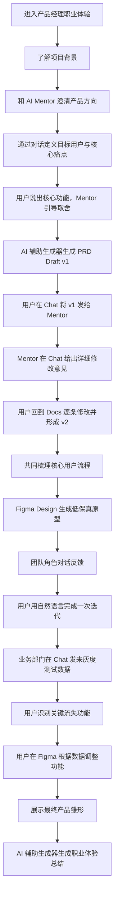
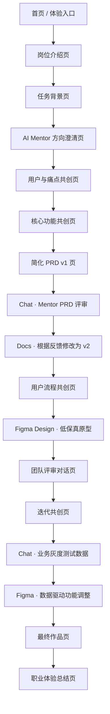

# PRD：产品经理职业体验 Demo

## 1. 文档信息

| 项目 | 内容 |
| --- | --- |
| 产品名称 | 职业体验模拟器 - 产品经理 Demo |
| 当前版本 | v0.1 |
| 文档类型 | 产品需求文档 PRD |
| 核心场景 | 大学生周末决策与出行 App |
| 目标体验时长 | 25-35 分钟 |
| 核心目标 | 让学生体验产品经理从模糊想法到产品雏形的成就感 |

## 2. 产品背景

很多学生对真实职业内容缺乏具体认知。传统职业教育通常停留在职业名称、行业介绍、薪资前景和就业方向层面，但学生很少能提前体验一个岗位真实会做什么、需要如何思考、如何与他人协作，以及这个职业的成就感来自哪里。

本项目希望通过职业任务模拟、AI 角色互动和阶段性反馈，让学生在低成本、低压力的环境中提前体验某个职业的核心工作过程。

第一版选择产品经理岗位作为 Demo，因为产品经理工作天然具备清晰的流程、角色协作、可视化成果和决策取舍，适合被设计成一段可互动、可反馈、可产生成就感的职业体验。

## 3. 产品定位

本产品不是一门产品经理课程，也不是求职训练营，而是一个职业体验型模拟器。

它的核心价值是：

> 让学生通过一次轻量但完整的模拟流程，感受到产品经理把模糊需求推进成可见产品的过程，并据此判断自己是否对这类工作产生兴趣
## 4. 核心设计原则

### 4.1 成就感优先于真实感

真实感是体验成立的约束，不是体验的最终目标。

第一版需要保留产品经理工作的典型特征，例如需求理解、功能取舍、流程设计、原型构思、团队沟通和反馈迭代。但如果某些真实工作细节会让体验变得冗长、痛苦或过度专业，应当进行简化。

体验应该让用户产生：

- “我做出了一个有形的产品雏形”
- “我的表达和取舍真的影响了产品方向”
- “我理解了产品经理为什么需要沟通和取舍”
- “这个职业的某些部分让我感兴趣”

### 4.2 用户不是来交作业的

PRD、流程图和原型不是最终目标，而是承载体验的工具。产品不应以“文档是否专业”为主要评价标准，而应以“用户是否在过程中体验到产品经理的思考方式和职业乐趣”为核心标准。

### 4.3 AI 不替用户完成任务

AI 的作用是扮演 Mentor、同事、业务方和用户，帮助用户推进任务、发现明显问题、体验团队协作。AI 不应直接替用户完成全部决策，否则用户会失去“自己做成了产品”的成就感。

### 4.4 Mentor 与生成器职责分离

本 Demo 中需要明确区分两类 AI 能力：

- AI Mentor：负责教导、启发、追问、纠偏、解释标准和推动用户做取舍
- AI 辅助生成器：负责根据用户输入和阶段上下文，生成或更新 PRD、功能清单、用户流程、低保真原型和总结等结构化产物

Mentor 的核心特点是“教导”，不是“代做”。它可以帮助用户理解为什么要收敛、哪里缺少闭环、下一步应该考虑什么，但不应直接替用户输出完整成品。

生成器的核心特点是“产物化”。当用户已经表达了想法、做出选择或回应反馈后，生成器可以把这些内容整理成可编辑草稿。

两者的协作原则是：

```text
用户表达想法
-> Mentor 追问、解释和提醒取舍
-> 用户确认方向或决策
-> AI 辅助生成器生成结构化草稿
-> Mentor 对草稿进行点评、解释和继续追问
```

允许 Mentor 做“确认式摘要”，例如“我理解你的重点是 A 和 B，接下来可以让生成器整理成功能草稿”。不允许 Mentor 直接说“我已经帮你整理好了完整功能方案”。

### 4.5 第一版控制复杂度

第一版采用固定场景、固定任务链、结构化产物和轻量反馈，但不采用选择题式产品设计。用户的产品方向、核心功能和迭代决策应该来自用户表达与 Mentor 引导，最终由 AI 辅助生成器整理成可编辑产物。

复杂度控制方式不是把用户框进预设选项，而是：

- 场景固定：仍然围绕“大学生周末决策与出行 App”
- 节点固定：仍然经历方向、用户、功能、流程、原型、反馈、迭代
- 输入开放：用户用自然语言表达自己的产品想法
- 输出结构化：AI 辅助生成器把用户已确认的内容整理成 PRD、流程图和原型草稿
- 追问受控：AI Mentor 每轮只追问 1-2 个关键问题，避免变成漫无目的聊天

## 5. 目标用户

### 5.1 愿景用户

所有希望了解真实职业内容、提前体验职业过程的学生，包括高中生、大学生和研究生。

### 5.2 第一版核心用户

第一版优先面向：

- 大学生
- 研究生
- 对互联网产品、商业创新、用户体验感兴趣的学生
- 想了解产品经理岗位但缺少真实接触机会的学生
- 正在思考实习、就业或职业方向的学生

### 5.3 用户核心需求

- 想知道产品经理到底在做什么
- 想体验一个真实但不沉重的职业流程
- 想判断自己是否喜欢这类工作方式
- 想获得一段有参与感、成就感和反馈感的体验

## 6. Demo 场景

### 6.1 场景名称

大学生周末决策与出行 App

### 6.2 场景背景

很多大学生周末想出去玩，但经常遇到以下问题：

- 预算有限，不知道去哪比较划算
- 时间有限，不想花太久做攻略
- 攻略信息分散，决策成本高
- 想和朋友一起去，但群聊只会堆叠个人偏好，看不见谁有不能退让的硬性限制
- 即使有几个候选方案，也没人知道为了达成一致需要谁牺牲什么
- 多数投票容易让少数人的底线被忽略，之后还会重新争论
- 担心路线太累、太贵或体验不好

现在用户将扮演一名产品经理，负责设计一款面向大学生的 C 端产品，帮助学生更轻松地做出周末出行或城市探索决策。

### 6.3 选择该场景的原因

- 贴近学生生活，用户容易产生真实想法
- 属于真实 C 端商业产品，不像校园课程作业
- 功能设计空间大，用户可以自由定义产品方向
- 适合体现产品经理的核心工作：理解用户、做取舍、组织方案、协调反馈
- 最终原型容易可视化，成就感强

## 7. 产品主轴

本 Demo 的主轴不是“从几个预设方向里选一个”，也不是把“避免争吵”停留在一句口号，而是：

```text
用户说出模糊想法
-> AI Mentor 追问和澄清
-> 用户确认一句清晰的产品方向
-> AI 辅助生成器生成方向草稿
-> 讨论第一版核心功能与真实冲突
-> 私下收集硬性限制与可妥协偏好
-> AI 辅助生成器组织共同点、冲突和妥协方案
-> Figma 原型体验接受 / 替代 / 否决的共识确认
-> 接受团队反馈并完成一次迭代
```

用户体验到的核心动作应该是“我把自己的想法聊清楚了，并推进成一个产品雏形”，而不是“我完成了一组选项题”。

“预算、时间、体验、社交、探索”等只能作为 Mentor 在对话中帮助用户思考的维度，不应作为开局的产品方向卡片。用户可以从任何真实感受出发，例如：

- “我和朋友周末总是决定不了去哪”
- “我想做一个帮人用 100 元玩一天的工具”
- “我想让不爱做攻略的人也能马上出发”
- “我想做一个小众地点防踩雷的产品”

### 7.1 对话式方向澄清与生成器整理

AI Mentor 的职责是帮助用户把自然语言想法聊清楚，而不是要求用户选择方向，也不是直接替用户完成产品方向成品。

Mentor 对话目标：

- 听懂用户想解决的具体麻烦
- 追问目标用户、典型场景和最痛的一步
- 帮用户判断方向是否需要收敛
- 保留用户的原创表达，不把用户强行归类到预设方向

AI 辅助生成器目标：

- 根据用户已确认的表达生成一句产品方向草稿
- 标注草稿中的目标用户、具体场景、核心痛点和第一版价值
- 允许用户继续用自然语言修改，而不是把草稿当成最终答案

方向产物格式：

```text
我想做一个面向 [目标用户] 的 [产品形态]，
帮助他们在 [具体场景] 中解决 [核心痛点]，
第一版先做到 [最小可验证价值]。
```

示例对话：

```text
用户：我想做一个让大学生周末出去玩不用在群里反复争论的 App。

AI Mentor：我理解你的重点不是“推荐更多地方”，而是帮一群人看见彼此的底线和可让步之处。这个想法挺适合做成产品。你觉得他们最卡住的是哪一步：时间对不上、预算不统一、体力不同，还是没人知道谁愿意妥协？

用户：主要是大家想法不一样，而且没人愿意做攻略。

AI Mentor：你的核心点已经比较清楚了：不是单纯推荐地点，而是让大家看见共同点、冲突和妥协成本。你可以先确认一下，第一版是不是要优先验证“大家能否确认一个不完美但都能接受的计划”？

用户：对，先解决这个。

AI 辅助生成器：产品方向草稿：面向想和朋友周末出门、但彼此有不同硬性限制的大学生小组，帮助他们私下提交约束、看见共同点与冲突，比较带妥协说明的方案，并确认一个所有人都能接受的共同计划。
```

## 8. 产品目标

### 8.1 用户体验目标

用户在 25-35 分钟内完成一次产品经理职业体验，并获得一个可见的产品雏形。

### 8.2 情绪目标

让用户在过程中产生：

- 探索感：我正在进入一个真实职业场景
- 掌控感：我可以决定产品往哪个方向走
- 协作感：我需要回应不同角色的意见
- 成就感：我把想法推进成了一个产品原型
- 自我判断：我能感受到自己是否喜欢这种工作

### 8.3 产品验证目标

第一版需要验证：

- 用户是否愿意完成完整体验
- 用户是否能理解产品经理的核心工作
- 用户是否觉得过程有成就感
- 用户是否愿意继续体验其他职业
- 用户是否愿意向同学推荐该体验

## 9. 非目标

第一版暂不追求：

- 教会用户完整的产品经理专业技能
- 输出可直接用于求职的作品集
- 完整模拟互联网公司的真实工作压力
- 完整商业模式建模
- 高保真 UI 设计
- 自由拖拽式原型编辑器
- 全开放式 AI 对话
- 多职业同时上线

## 10. 核心体验流程



## 11. 用户流程

### 11.1 Step 1：进入体验

用户看到产品经理岗位说明和本次任务背景。

页面目标：

- 快速建立代入感
- 告诉用户本次不是考试
- 明确最终会做出一个产品雏形

建议文案：

> 你将扮演一名产品经理，用 30 分钟设计一款面向大学生的周末决策与出行 App。你不需要专业经验，只需要说出你的想法、和 AI Mentor 讨论取舍，并让 AI 辅助生成器把你的决策变成可编辑的产品雏形。

### 11.2 Step 2：和 AI Mentor 澄清产品方向

用户不从方向卡片里做选择，而是在对话框中用自然语言描述自己想做的产品。

页面输入提示：

> 你想帮大学生解决哪一个周末出行或城市探索里的麻烦？可以随便说，不需要专业。

AI Mentor 行为：

- 先复述用户想法，确认自己理解是否正确
- 追问 1-2 个问题，帮助用户明确目标用户和具体场景
- 引导用户确认第一版最想解决的问题
- 允许用户继续修改，而不是要求用户从备选方向中确认

AI 辅助生成器行为：

- 在用户确认后生成一句产品方向草稿
- 将产品方向拆成目标用户、场景、痛点和第一版价值
- 保持草稿可编辑，允许用户继续用口语修改

示例对话：

```text
用户：我想做一个帮大学生周末找地方玩的 App，但不要那种旅游攻略，很麻烦。

AI Mentor：我听到两个重点：你想服务“周末临时想出去玩”的学生，同时想减少做攻略的负担。你更想解决的是“不知道去哪”，还是“知道一些地方但懒得规划路线”？

用户：更像是懒得规划路线，最好告诉我半天能怎么玩。

AI Mentor：这个方向已经比较明确了。你想优先解决的是“懒得规划路线”，而不是做一个完整旅游攻略工具，对吗？

用户：对。

AI 辅助生成器：产品方向草稿：面向周末临时想出门、但不想做攻略的大学生，帮助他们根据时间、预算和偏好快速生成半日出行方案。你可以继续直接修改这句话。
```

### 11.3 Step 3：定义用户与痛点

用户继续通过对话补充目标用户和痛点，而不是勾选用户类型。

AI Mentor 追问方向：

- 这个产品最先服务哪类学生？
- 他们通常在什么时候遇到这个问题？
- 现在他们是怎么解决的？
- 当前方式最麻烦或最让人放弃的一步是什么？
- 如果第一版只能解决一个问题，用户最希望它解决什么？

用户确认后，AI 辅助生成器生成“用户与痛点卡片”：

```text
目标用户：周末临时想出门、但不愿意做详细攻略的大学生
典型场景：周五晚上或周六上午临时决定出去玩
核心痛点：路线规划麻烦，不知道半天时间是否够玩
第一版目标：快速生成一个时间可控、预算大致清楚的半日路线
```

用户可以直接对卡片说：

```text
“把目标用户改成两三个朋友一起出门的人”
“预算也很重要，加进去”
“不要强调小众地点，先强调省心”
```

### 11.4 Step 4：说出核心功能

用户不从功能池里选择，而是用自然语言说“这个产品应该能做什么”。AI Mentor 负责追问功能背后的目的、提醒第一版范围和取舍；AI 辅助生成器负责把用户描述拆成候选功能草稿。

页面输入提示：

> 如果这个 App 第一版上线，你希望用户打开后能完成哪几件事？用口语说就可以。

AI Mentor 行为：

- 追问每个功能要解决的用户问题
- 引导用户区分“第一版必须有”和“以后可以做”
- 指出缺少闭环的地方
- 不直接替用户拍板，而是提出取舍问题

AI 辅助生成器行为：

- 根据用户已表达的想法生成候选功能清单
- 把功能分成第一版核心功能和后续版本功能
- 根据用户决策更新功能范围草稿

示例对话：

```text
用户：我想让它能输入预算和时间，也能发给朋友看，但不想最后又靠投票把一个人的底线盖掉。

AI Mentor：这里面有两个可能的核心：一个是“单人快速生成路线”，另一个是“朋友一起看见限制并达成共识”。你觉得第一版更应该验证哪一个？

用户：我觉得共识机制是核心，因为我的出发点就是大家决定不了，而且多数票经常让一个人不舒服。

AI 辅助生成器：候选功能草稿：

1. 第一版核心功能：发起出行计划、私下收集硬性限制与可妥协偏好、识别共同点与冲突、生成带妥协说明的方案、成员接受 / 替代 / 否决
2. 第一版辅助字段：时间、预算、偏好
3. 后续版本功能：AA 拆账、优惠提醒、复杂攻略详情

AI Mentor：这个草稿的主线是完整的。你现在要做的取舍是：第一版先把推荐做得更丰富，还是先保证成员能看见冲突与妥协成本？如果核心痛点是达成一致，后者应该优先。
```

### 11.5 Step 5：生成简化 PRD

AI 辅助生成器根据前面的对话生成一份简化 PRD。PRD 不是让用户从零写，也不是根据选项拼接，而是生成器对用户已确认内容的结构化整理。

这一阶段必须完整呈现一次文档评审往返，而不是让修改意见直接出现在 Docs 中：

```text
用户在 Docs 触发生成 PRD Draft v1
-> 用户进入 Chat，将 v1 发送给 Mentor 并说明希望重点评审的内容
-> Mentor 在 Chat 中完整阅读并给出详细修改意见
-> 用户回到 Docs，与 PRD Copilot 对话说明每一轮如何修改
-> Copilot 自动生成并同步修改后的 PRD 草稿
-> 所有意见处理完成后形成 Draft v2，再进入流程设计
```

AI Mentor 在这一阶段不负责直接产出或自动改写 PRD，而是负责解释问题、给出修改原因和可执行建议。用户必须先在 Chat 发出草稿，系统才能展示 Mentor 反馈；Mentor 回复前，Docs 不应提前出现评审意见。

Mentor 的意见返回 Docs 后，由 PRD Copilot 承接修改过程。Copilot 先展示当前评审上下文，再让用户用自然语言确认取舍；用户发送后，Copilot 自动把这一轮内容写回 PRD，并在 Revision log 中留下记录。用户不需要逐条点击“应用修改”，也不需要直接编辑结构化字段。

Mentor 的 PRD 反馈固定覆盖以下四个维度，避免泛泛点评：

- 产品目标是否是可验证的行为假设
- MVP 范围是否收敛，Out of scope 是否明确
- 成功指标是否有具体阈值并对应核心漏斗
- 功能验收标准是否覆盖关键体验约束和异常状态

返回 Docs 后，用户通过 Copilot 对话逐项生成修改。界面需要展示“原始 v1、Copilot 当前上下文、对话记录、已生成内容和 v2 状态”，并在所有评审项处理完成前暂不开放 Figma。

简化 PRD 包含：

- 产品目标
- 目标用户
- 核心痛点
- 核心功能
- 第一版范围
- 暂不做内容

用户可以用自然语言修改：

```text
“核心痛点写得太泛了，改成朋友之间很难统一意见”
“第一版不要做登录”
“暂不做内容里加上复杂社交关系链”
```

### 11.6 Step 6：共同梳理核心用户流程

系统不要求用户选择标准流程模板，而是让用户描述“一个真实用户会怎么用”。AI Mentor 负责追问流程断点和顺序问题；AI 辅助生成器负责将用户确认后的路径整理成流程图。

页面输入提示：

> 想象一个用户第一次打开你的 App，他从进入到完成计划，大概会经历哪几步？

示例对话：

```text
用户：他先创建一个周末计划，填时间和预算，然后发给朋友；每个人私下写必须满足和可以妥协的条件，系统先汇总共同点与冲突，再给几个有妥协说明的方案。

AI Mentor：这个流程能跑通。我发现有一个顺序问题：是先让成员公开表达再比较方案，还是先私下收集底线、再公开冲突摘要？后者更能避免身份和立场先对撞，也更符合你想解决的痛点。

用户：先私下填约束，再生成冲突摘要和妥协方案。

AI 辅助生成器：核心流程草稿：创建计划 -> 私下提交硬性限制 -> 汇总共同点与冲突 -> 比较妥协方案 -> 接受 / 提出替代 / 否决 -> 确认共同计划。
```

系统将流程可视化为流程图，用户可以继续用自然语言调整节点。Mentor 只对流程是否清楚、是否断点过多、是否符合第一版目标进行点评。

### 11.7 Step 7：生成低保真原型

用户进入类 Figma 的 Design 工作区。AI 辅助生成器先根据 PRD 和流程生成低保真 Frame，用户再完成一次真正的原型设计，而不是只点击“生成结果”：选择 Frame、编辑页面名称和用途、调整图层内容、设置页面跳转关系，并进入 Present 模式走通一次。

Figma 工作区包含：

- Pages / Layers：浏览页面和页面内模块
- Design Canvas：查看并选择手机 Frame
- Design Inspector：编辑页面名称、用途、图层和尺寸信息
- Prototype Inspector：配置 On tap 跳转目标、动画和起始页面
- Present：以用户视角点击体验原型

建议页面由系统根据用户方案生成，常见页面可能包括：

- 发起计划页
- 邀请成员页
- 私人约束页
- 共同点与冲突页
- 妥协方案页
- 共识确认页
- 最终计划页

用户调整方式：

```text
“首页太复杂了，先只保留创建计划”
“共识页要显示每个成员的选择状态和妥协成本”
“方案页把共同点和冲突放到最上面”
“最终计划页加一个复制到群聊的按钮”
```

Demo 至少要求用户修改一个 Frame 的图层，并用 Present 模式完成一次页面跳转后，才进入团队反馈阶段。

### 11.8 Step 8：团队角色反馈

用户进入一次轻量团队评审。评审采用“群聊式对话”，而不是一次性展示一堆反馈，也不是让用户在预设迭代方案里选择。

团队角色不是一个泛化的“开发同事”，而是拆成多个角色，让用户体验产品经理面对不同协作者时的沟通与取舍。

### 11.8.1 Demo 阶段交互形式

页面结构：

- 左侧：当前产品方案摘要，包括产品方向、核心用户、核心流程、原型缩略图
- 右侧：团队评审聊天室
- 底部：用户自由输入框，提示为“你想怎么回应这轮反馈？”

每轮只出现 3 个角色，避免用户压力过大。推荐 Demo 固定使用：

- 业务负责人：关注第一版目标和范围
- 前端开发：关注页面结构和交互是否清楚
- 模拟用户：关注真实使用感受

如果用户方案明显涉及推荐规则或异常流程，可以替换或追加后端开发、测试同事，但 Demo 阶段不建议超过 3 个角色同时发言。

用户不是选择“采纳 A / 采纳 B / 不采纳”，而是用自然语言回应：

```text
“我想保留私下表达约束，但把 AA 拆账放到后面”
“前端说得对，把私下约束、冲突摘要和共识确认拆成三种状态”
“用户反馈让我觉得不能只给一个推荐分数，要展示谁需要付出什么妥协”
```

用户回应后，AI 辅助生成器将其整理成“本轮迭代决策”。AI Mentor 负责确认这些决策是否回应了团队反馈，以及是否仍符合第一版范围。

### 11.8.2 Demo 对话脚本示例

以下脚本以用户已经做出的方案为例：

```text
产品方向：帮助大学生和朋友看见约束与妥协成本，确认一个可接受的周末计划
目标用户：想和朋友一起出门、但彼此有不同硬性限制的大学生小组
核心功能：发起计划、私下提交约束、识别共同点与冲突、比较妥协方案、共识确认
核心流程：创建计划 -> 私下提交硬性限制 -> 汇总共同点与冲突 -> 比较妥协方案 -> 接受 / 替代 / 否决 -> 确认共同计划
```

评审开始：

```text
AI Mentor：我会把你的产品方案拿去做一次轻量团队评审。你不用马上改所有东西，先听不同角色最关心什么，然后决定第一版要改哪一处。
```

业务负责人反馈：

```text
业务负责人：我觉得这个方向是成立的，因为它解决的是“朋友之间迟迟定不下来”的问题。我的担心是如果最后还是用多数投票，少数人的硬性限制会被掩盖，之后还会重新争论。

业务负责人：如果我们只验证一个关键假设，我建议验证“成员能不能看见冲突和妥协成本，并在 15 分钟内确认一个都能接受的计划”。所以第一版最好把主路径压到：发起计划、私下提交约束、冲突摘要、共识确认。复杂的攻略详情、AA 拆账、优惠提醒可以先不做。
```

前端开发反馈：

```text
前端开发：从页面实现看，我最担心的是硬性限制、可妥协偏好和协商状态混在一张表单里。用户可能填完了，却不知道这些信息会怎样影响方案。

前端开发：我建议把状态拆成三张轻量卡：私下约束卡、共同点与冲突卡、妥协方案卡。每张卡只完成一个动作，成员不需要在群聊里先公开自己和谁冲突。
```

模拟用户反馈：

```text
模拟用户：如果朋友发我一个链接，我愿意点开看，但我不想填很多东西。我最想知道的是：哪些条件大家都同意、冲突在哪里、为了这个方案谁需要让步。

模拟用户：如果每个方案能直接写清楚“满足哪些底线、谁多走 10 分钟、不同意时怎么提出替代”，我会更愿意确认。
```

AI Mentor 推进用户回应：

```text
AI Mentor：这三条反馈其实指向同一个问题：第一版不只是降低填写成本，还要把“冲突如何被看见、妥协如何被解释”做成产品能力。

AI Mentor：你可以直接说你想怎么改。比如保留哪个核心动作、删掉什么、哪个页面要变简单。不用选答案，用自己的话说。
```

用户回应示例：

```text
用户：那我想把朋友端改成私下填写硬性限制和可妥协项，不先暴露身份。方案卡片重点显示共同点、冲突和每个人的妥协成本，并允许接受、提出替代或说明否决原因。AA 拆账和详细攻略先不做。
```

AI 辅助生成器整理为迭代决策：

```text
AI 辅助生成器：本轮迭代决策：

1. 保留核心主线：发起计划 -> 私下提交约束 -> 汇总共同点与冲突 -> 比较妥协方案 -> 共识确认
2. 简化成员输入：硬性限制与可妥协偏好分开，身份在汇总前不暴露
3. 强化方案卡片：优先展示共同点、冲突摘要、个人妥协成本和替代入口
4. 暂不做：AA 拆账、完整攻略详情、复杂优惠提醒

系统会把这些更新到 PRD、流程图和低保真原型里。
```

### 11.8.3 角色反馈内容规则

每个角色反馈都遵循三段式：

```text
我看到的价值：指出方案中已经成立的部分
我担心的问题：指出会影响第一版体验或实现的风险
我建议你考虑：提出一个需要用户做取舍的问题
```

禁止反馈形式：

- 不打分
- 不说“正确答案”
- 不让用户从固定迭代项里选择
- 不输出过长专业术语
- 不一次性要求用户改 5 个以上问题

### 11.9 Step 9：完成一次迭代

用户根据团队反馈，用自然语言说明自己想如何调整。AI Mentor 先确认用户的取舍逻辑是否清楚；AI 辅助生成器再将用户回应转化为可执行修改，并更新 PRD、流程图和低保真原型。

迭代结果应展示：

- 用户原始回应
- AI 辅助生成器整理后的迭代决策
- PRD 更新点
- 流程图前后变化
- 原型前后变化
- 被明确放到后续版本的内容

### 11.10 Step 10：根据业务测试数据调整功能

原型完成后，业务部门在 Chat 中主动发来一轮小范围灰度测试数据。数据不能只作为装饰，而要明确指向一个需要调整的功能，并包含“当前值、目标值和主要流失点”。

Demo 固定数据：

- 测试样本：20 组学生
- 计划创建完成率：72%，基本符合预期
- 约束提交率：68%，接近 70% 目标
- 可接受方案确认率：42%，低于 60% 目标
- 达成共识耗时：23 分钟，高于 15 分钟目标
- 录屏观察：成员大多完成了私下填写，却在方案卡前重新争论，因为看不见共同点、冲突和谁需要牺牲什么

用户需要先在 Chat 中解释自己对数据的判断，再回到 Figma 调整对应功能。第一版固定调整为：在共识方案卡中补充共同点、冲突摘要、个人妥协成本，并提供接受、提出替代或否决并说明原因的入口，同时保留邀请失败时重新复制链接的兜底。

Figma 需要以 linked insight 的形式展示测试数据、异常指标和调整建议。用户创建“共识方案 / v2” Frame，并更新页面跳转关系；完成修改后，共识方案页面与流程节点都要发生可见变化，并记录一条数据驱动的迭代决策。

### 11.11 Step 11：职业体验总结

体验结束后，AI 辅助生成器生成职业体验总结草稿，AI Mentor 负责解释这段体验对应了哪些产品经理工作特征。

总结不应像考试评分，而应像一次职业体验复盘。

总结内容：

- 你聊出来的产品方向
- 你完成的产品雏形
- 你经历的 PM 工作环节
- 你在过程中体现出的倾向
- 你可能喜欢或不喜欢产品经理工作的哪些部分
- 推荐你继续体验的职业方向

## 12. 角色系统

### 12.1 角色总览

| 角色 | 作用 | 出现阶段 |
| --- | --- | --- |
| Mentor | 指导、纠错、推进体验 | 全流程 |
| AI 辅助生成器 | 将用户已确认内容产物化 | 方向、PRD、流程、原型、迭代、总结 |
| 业务负责人 | 提供业务目标和优先级压力 | 需求定义、迭代阶段 |
| 前端开发 | 关注页面结构、交互状态、实现复杂度 | 原型后 |
| 后端开发 | 关注数据、规则、接口、推荐逻辑 | 流程和功能后 |
| 测试同事 | 关注异常路径、边界情况、流程是否走得通 | 原型后 |
| 模拟用户 | 提供使用感受和真实偏好 | 反馈阶段 |

### 12.2 Mentor

定位：

Mentor 是体验的主线陪伴者，帮助用户理解当前任务、发现明显漏洞，并推动用户进入下一步。

语气：

- 温和
- 清晰
- 不苛刻
- 不替用户做决定

职责：

- 解释当前任务
- 追问用户的真实想法
- 指出明显问题
- 提供 1-2 个取舍问题
- 控制体验节奏
- 对生成器产物进行点评和教学解释
- 在用户确认后触发 AI 辅助生成器产出草稿

示例反馈：

> 你现在的想法里同时包含“帮朋友快速达成一致”和“生成完整攻略”。如果第一版要验证一个最核心价值，我建议先聚焦“让朋友更快确认一个共同计划”。完整攻略可以作为路线详情里的轻量信息，而不是第一版主功能。

边界限制：

- 不直接替用户输出完整功能方案
- 不把自己的建议包装成最终答案
- 不用“我已经帮你整理好了”来代替用户决策
- 不在用户尚未确认前生成完整 PRD、流程图或原型

### 12.3 AI 辅助生成器

定位：

AI 辅助生成器是产物化工具，负责把用户已表达、已确认或已决策的内容整理成可编辑草稿。

语气：

- 简洁
- 结构化
- 明确标注“草稿”
- 不冒充 Mentor 进行教学

职责：

- 生成产品方向草稿
- 生成用户与痛点卡片
- 生成候选功能清单
- 生成简化 PRD
- 生成核心用户流程
- 生成低保真原型草稿
- 根据迭代决策更新产物
- 生成职业体验总结草稿

边界限制：

- 不主动替用户决定优先级
- 不在用户未确认方向时输出完整方案
- 不对用户进行职业教学或评价
- 所有输出都应保持可编辑，并显式说明是草稿

示例输出：

> 功能草稿：根据你刚才确认的方向，我先生成一个可编辑版本。第一版核心功能包括发起计划、私下提交硬性限制与可妥协偏好、识别共同点与冲突、生成带妥协说明的方案、接受 / 替代 / 否决并确认共同计划。后续版本可以考虑 AA 拆账、优惠提醒和完整攻略详情。

### 12.4 业务负责人

定位：

业务负责人代表产品目标和第一版范围，帮助用户理解产品经理需要做取舍。

关注点：

- 第一版目标是否清晰
- 功能是否过多
- 是否能形成核心价值
- 是否有基本商业想象

示例反馈：

> 我们第一版不要做完整旅游平台，先验证学生是否愿意用它完成一次周末计划。你能不能把最核心路径收敛到 3 个页面？

### 12.5 前端开发

定位：

前端开发代表页面实现和用户交互，帮助用户意识到功能需要变成具体界面。

关注点：

- 页面信息是否太多
- 用户点击路径是否清楚
- 是否有加载、空状态、错误状态
- 移动端展示是否合理

示例反馈：

> 方案详情页现在包含价格、交通、景点、评论、天气和成员选择，信息有点多。第一版能不能先突出共同点、冲突和谁需要付出什么妥协成本？

### 12.6 后端开发

定位：

后端开发代表数据和业务规则，帮助用户意识到“智能推荐”等功能需要明确规则。

关注点：

- 推荐规则是否清楚
- 预算计算方式是否明确
- 数据从哪里来
- 是否需要登录
- 接口是否过多

示例反馈：

> 如果要做“智能推荐”，第一版需要先定义简单规则。比如按预算、时间和出行强度筛选，而不是一开始就做复杂算法。

### 12.7 测试同事

定位：

测试同事帮助用户发现流程中的断点和异常情况。

关注点：

- 用户不填预算怎么办
- 没有推荐结果怎么办
- 朋友没有回应怎么办
- 用户中途退出怎么办
- 价格变化怎么办

示例反馈：

> 如果用户邀请朋友后一直没人投票，流程会卡住。是否需要一个“自己先确认计划”的入口？

### 12.8 模拟用户

定位：

模拟用户提供真实感受，让用户体验从用户反馈中优化产品。

第一版不需要模拟某一个具体用户，可以模拟几类典型反馈：

- 省钱但怕麻烦的用户
- 想出去玩但不想做攻略的用户
- 想和朋友一起但怕意见不统一的用户
- 喜欢小众地点但担心踩雷的用户

示例反馈：

> 我想要便宜，但我不想行程太累。如果推荐结果能告诉我“轻松程度”，我会更敢选。

## 13. 信息架构



## 14. 页面需求

### 14.1 首页 / 体验入口

页面内容：

- 产品经理职业体验标题
- 本次任务简介
- 预计体验时长
- 开始体验按钮

核心目标：

- 降低用户心理负担
- 让用户知道这不是考试

### 14.2 岗位介绍页

页面内容：

- 产品经理在本次体验中的任务说明
- 本次会经历的关键环节
- 最终会得到的产品雏形

不应出现大量职业百科式介绍。

### 14.3 任务背景页

页面内容：

- 大学生周末出行痛点
- 产品任务
- 业务目标

### 14.4 AI Mentor 方向澄清页

页面内容：

- AI Mentor 对话区
- 用户自由输入框
- AI 辅助生成器输出的当前产品方向草稿
- “我想改一下方向”入口

核心目标：

- 让用户从自己的真实想法出发
- 让 AI Mentor 通过追问帮助用户澄清方向
- 让 AI 辅助生成器输出一句清晰但可修改的产品方向草稿

### 14.5 用户与痛点共创页

页面内容：

- AI Mentor 追问区
- 用户自然语言回答区
- 目标用户与痛点摘要卡片
- 可编辑的一句话产品目标

核心目标：

- 让 Mentor 帮用户说清楚目标用户、典型场景、核心痛点和第一版目标
- 让 AI 辅助生成器把用户已确认内容整理成摘要卡片
- 允许用户直接用口语修改摘要

### 14.6 核心功能共创页

页面内容：

- 用户描述“产品应该能做什么”的输入区
- AI 辅助生成器生成的功能草稿
- 第一版范围与后续版本范围
- 缺失闭环提示

规则：

- 不展示预设功能池
- 不要求用户勾选功能
- 功能过多时，AI Mentor 用取舍问题引导用户收敛
- 功能过少时，AI Mentor 提醒缺失的核心闭环
- 功能草稿由 AI 辅助生成器输出，并明确标注为可编辑草稿

### 14.7 简化 PRD 页

页面内容：

- AI 辅助生成器自动生成的 PRD Draft v1
- PRD Copilot 对话区
- Draft v1 生成后，在桌面 Chat 应用图标旁出现“发给 Mentor 评审”的提示气泡
- Mentor 回复后才出现的评审上下文
- Copilot 的用户消息、AI 回复和自动生成记录
- 当前修改进度、Revision log 和 Draft v2 状态

交互规则：

- v1 生成前，不展示任何预制评审意见
- v1 生成后，不在 Docs 工具栏增加跨应用按钮；通过 Chat 应用图标旁的提示气泡引导用户自然切换
- 用户进入 Chat 后主动将草稿发送给 Mentor
- Mentor 的详细意见首先完整出现在 Chat，再同步到 Docs
- 用户在 Docs 中与 Copilot 对话描述每一轮怎么改
- Copilot 自动更新正文，用户消息和生成结果进入 Revision log
- 全部意见处理完成后，在 Figma 应用图标旁出现下一步提示气泡

### 14.8 用户流程共创页

页面内容：

- 当前核心路径
- 流程节点
- 用户自然语言调整入口
- AI Mentor 对流程断点的提示

### 14.9 Figma Design 原型页

页面内容：

- Pages / Layers 页面列表
- Design Canvas 与手机 Frame
- 选中 Frame 后的 Design Inspector
- 图层编辑、增加和删除
- Prototype Inspector 中的页面跳转关系
- Present 预览模式
- 从 Chat 同步来的 linked insight 和数据驱动的 v2 Frame

### 14.10 团队反馈页

页面内容：

- 角色头像或名称
- 团队评审聊天室
- 当前产品方案摘要
- 用户自由回应输入框
- AI 辅助生成器迭代决策整理

第一版建议一次只展示 2-3 个角色反馈。

### 14.11 迭代共创页

页面内容：

- 反馈总结
- 用户原始回应
- AI 辅助生成器整理后的迭代决策
- 迭代前后对比

### 14.12 数据驱动功能调整页

页面内容：

- 业务部门发来的测试样本与关键漏斗
- 用异常色突出低于目标的朋友偏好提交率
- 数据对应的用户行为观察与流失原因
- 只针对问题功能的调整操作
- 调整后的流程节点、页面模块和迭代记录

### 14.13 最终作品页

页面内容：

- 产品名称
- 产品方向
- 核心用户
- 核心功能
- 流程图
- 低保真原型预览
- 迭代记录

### 14.14 职业体验总结页

页面内容：

- 本次完成内容
- 用户表达和取舍倾向
- 体验中的亮点
- 产品经理职业特征总结
- 推荐继续探索的方向

## 15. AI 方案

### 15.1 第一版建议

第一版可以采用“固定任务节点 + 受控 AI Mentor + AI 辅助生成器”的方式。

如果完全不接 AI，只能验证流程是否顺畅，很难验证实时互动是否带来职业体验感。

如果完全开放 AI，对话容易跑偏，开发成本和稳定性风险较高。因此第一版不是无边界聊天，而是在固定任务节点中允许用户开放表达。

推荐方案：

- 场景固定
- 任务固定
- 角色固定
- 评价标准固定
- 用户自然语言输入
- AI Mentor 在限定上下文内追问、解释、纠偏和生成反馈
- AI 辅助生成器在用户确认后输出结构化产物
- 系统把生成器结果落到 PRD、流程图、原型和总结中

### 15.2 无 AI Demo 备选方案

如果早期只是用于展示概念，可以先做无 AI 点击原型，但它只能展示界面形态，不能验证核心体验。

实现方式：

- 用预设的一条用户输入脚本演示从想法到产物的过程
- 团队角色反馈采用固定剧本
- 职业总结采用固定样例
- 页面表现仍保持“对话式”，不要退回方向卡片和功能池

该方案适合讲概念，但不足以验证“用户能不能通过 AI Mentor 澄清方向，并通过 AI 辅助生成器得到自己的产品雏形”这一核心价值。

### 15.3 轻量 AI Demo 方案

更推荐第一版用户测试使用轻量 AI。

AI 输入：

- 用户原始输入
- 用户与 AI Mentor 的对话历史
- 用户已确认的产品方向
- 用户已确认的目标用户、痛点和功能范围
- 当前 PRD 内容
- 当前流程图节点
- 当前原型页面

AI 输出：

- Mentor 提示
- 角色反馈
- 用户反馈
- 生成器草稿，包括产品方向、功能清单、PRD、流程图、低保真原型和职业体验总结
- 迭代决策整理

AI 输出必须遵循：

- 不直接替用户完成全部内容
- 每次最多给 2-3 条建议
- 每轮最多追问 1-2 个问题
- 不把建议包装成固定选择题
- 保持鼓励和推进感
- 不做过度专业批判
- 优先指出会影响流程继续的问题
- Mentor 输出只负责引导和点评，生成器输出只负责产物化
- 生成器不得在用户未确认前输出完整方案

## 16. 关键体验细节

### 16.1 如何体现产品经理的职业成就感

产品经理的独特成就感可以被拆成四件事：

1. 把模糊需求讲清楚
2. 在多个目标之间做取舍
3. 让不同角色围绕同一个方向协作
4. 把想法变成可见的产品雏形

本 Demo 需要让用户实际经历这四件事。

### 16.2 如何避免变成课程作业

- 不要求用户从零写完整 PRD
- 不以专业术语考试为导向
- 不用“正确答案”评价用户
- 每一步都生成可见变化
- 让用户持续表达、讨论和取舍，而不是填选项或交作业

### 16.3 如何避免体验过于真实导致不快乐

- 减少冗长会议和复杂文档
- 不模拟高压否定式反馈
- 不要求用户处理大量细节
- 团队反馈以建设性问题为主
- 每轮反馈后都由 AI Mentor 引导用户做取舍，再由 AI 辅助生成器整理成一条可执行迭代

## 17. 成功指标

### 17.1 行为指标

- 完成率
- 平均体验时长
- 每一步流失率
- 用户主动修改次数
- 用户完成迭代比例

### 17.2 体验指标

通过问卷或访谈验证：

- 是否觉得自己完成了一个产品
- 是否理解产品经理大概做什么
- 是否感受到成就感
- 是否愿意体验其他职业
- 是否愿意推荐给同学

### 17.3 学习和决策指标

- 用户是否能说出产品经理的 2-3 个核心工作内容
- 用户是否能判断自己喜欢或不喜欢哪些环节
- 用户是否对某类职业产生进一步探索意愿

## 18. MVP 范围

第一版只做：

- 一个职业：产品经理
- 一个场景：大学生周末决策与出行 App
- 一个固定问题域中的自由产品方向表达
- 一套 AI Mentor 引导对话流程
- 一套 AI 辅助生成器产物化流程
- 一条完整任务链
- 一个简化 PRD 生成流程
- 一个流程图生成流程
- 一个低保真原型生成流程
- 一轮团队反馈
- 一次迭代
- 一份职业体验总结

第一版不做：

- 多职业
- 多场景自由选择
- 高保真原型工具
- 完整项目管理系统
- 完整求职作品集导出
- 复杂 AI Agent 协作

## 19. 风险与应对

| 风险 | 表现 | 应对 |
| --- | --- | --- |
| 体验像课程作业 | 用户觉得是在写文档 | 减少从零输入，用对话和即时可视化推进 |
| 真实感过强 | 用户觉得累、烦、压力大 | 只保留关键冲突，反馈以推进为主 |
| AI 跑偏 | 输出过度发散或不稳定 | 使用固定上下文、角色模板和输出约束 |
| 角色边界漂移 | Mentor 直接替用户生成成品，削弱用户参与感 | 将 Mentor 提示词和生成器提示词拆分，产物生成必须由用户确认触发 |
| 功能过多 | 用户陷入堆功能 | Mentor 用取舍问题帮助用户收敛第一版闭环 |
| 成就感不足 | 用户只完成表单，没有作品感 | 强化最终作品页和迭代前后对比 |
| 职业理解偏差 | 用户误以为 PM 只是画原型 | 在总结中强调需求、取舍和协作 |

## 20. 后续迭代方向

### 20.1 职业扩展

可扩展职业：

- UI/UX 设计师
- 运营
- 市场营销
- 数据分析师
- 咨询顾问
- 前端开发
- 法务
- 教师

### 20.2 场景扩展

产品经理岗位可扩展场景：

- 大学生消费决策 App
- 校园社交产品
- AI 学习助手
- 实习信息平台
- 健康管理产品
- 内容社区产品

### 20.3 体验增强

- 多结局体验
- 职业兴趣画像
- 作品导出
- 班级或课程后台
- 教师查看体验报告
- 小组协作模式

## 21. 待确认问题

1. 第一版是否接入真实 AI，还是先做规则化 Demo？
2. 第一版面向个人体验，还是课堂中的批量体验？
3. 是否需要教师端或管理端？
4. 最终作品是否需要支持导出？
5. 单次体验时长是否严格控制在 30 分钟内？
6. 第一版视觉风格更偏游戏化，还是偏职业工作台？

## 22. Demo 实现方案建议

### 22.1 推荐 Demo 形态

第一版建议做成一个可运行的 Web Demo，而不是纯静态演示稿。

核心目标不是一次性做完整产品，而是验证三件事：

1. 用户是否愿意用自然语言表达产品想法
2. Mentor 的追问是否能帮助用户更清楚地做取舍
3. AI 辅助生成器生成的 PRD、流程和原型是否能带来作品感

### 22.2 技术路线

推荐使用轻量前端单页应用：

- 前端：React + TypeScript + Vite
- 样式：Tailwind CSS 或普通 CSS Modules
- 状态管理：前端本地状态即可，第一版不需要复杂全局状态库
- 数据持久化：先用 localStorage 保存体验进度
- AI 接入：前期可做 mock 生成器，用户测试版再接真实 AI
- 部署：Vercel、Netlify 或任意静态站点托管

如果需要接真实 AI，建议增加一个极薄的后端 API 层：

- `/api/mentor`：只负责 Mentor 追问、解释、点评
- `/api/generator`：只负责产物生成和产物更新
- `/api/review-roles`：只负责业务负责人、前端开发、模拟用户等角色反馈

不要把所有 AI 能力放进一个通用聊天接口，否则很容易再次混淆 Mentor 和生成器的职责。

### 22.3 页面结构

Demo 可以先压缩成 6 个主页面：

1. 体验入口：说明任务背景和最终产物
2. 方向澄清：用户输入想法，Mentor 追问，生成器生成方向草稿
3. 功能与 PRD：Mentor 引导取舍，生成器生成简化 PRD
4. 流程与原型：生成器生成流程图和低保真页面，Mentor 解释页面价值
5. 团队评审与迭代：角色反馈，用户回应，生成器更新产物
6. 最终作品与总结：展示最终 PRD、流程、原型和职业体验总结

这样比 13 个页面更适合第一版开发，但不会牺牲核心体验链路。

### 22.4 数据模型

前端可以维护一个 `experienceState`：

```text
productDirection
targetUser
painPoint
coreFeatures
laterFeatures
prdDraft
flowNodes
prototypeScreens
teamFeedback
iterationDecision
finalSummary
chatHistory
currentStep
```

每一步只更新对应字段，最终作品页直接读取这份状态生成完整展示。

### 22.5 AI 职责拆分实现

建议将提示词拆成三类：

1. Mentor Prompt
   - 输入：当前步骤、用户输入、当前产物摘要
   - 输出：1-2 个追问、解释或取舍提醒
   - 禁止：直接生成完整 PRD、完整功能清单、完整流程图

2. Generator Prompt
   - 输入：用户已确认内容、当前步骤、当前产物版本
   - 输出：结构化 JSON 草稿
   - 禁止：教育用户、评价用户、主动替用户决定优先级

3. Role Feedback Prompt
   - 输入：当前产品方案
   - 输出：角色反馈，固定包含“看到的价值 / 担心的问题 / 建议你考虑”
   - 禁止：打分、给标准答案、一次要求用户改太多

### 22.6 第一版开发顺序

建议按以下顺序实现：

1. 先做无 AI 的完整状态流转和页面骨架
2. 用固定 mock 数据跑通从方向到最终总结的链路
3. 接入 mock Mentor 和 mock 生成器，验证角色边界是否清楚
4. 再把生成器接口替换为真实 AI
5. 最后接入 Mentor 和团队角色反馈的真实 AI

这个顺序可以降低风险：即使 AI 暂时不稳定，Demo 的体验链路仍然能完整跑通。

### 22.7 验收标准

Demo 完成时至少需要满足：

- 用户可以从一句自然语言想法开始体验
- Mentor 每轮只做追问、解释、点评或取舍提醒
- 生成器产物明确标注为草稿，且可被用户继续修改
- 用户能看到 PRD、流程图、低保真原型和迭代前后变化
- 团队反馈不会直接给标准答案，而是推动用户做一次取舍
- 最终作品页能让用户感到“这是我参与做出来的产品雏形”
